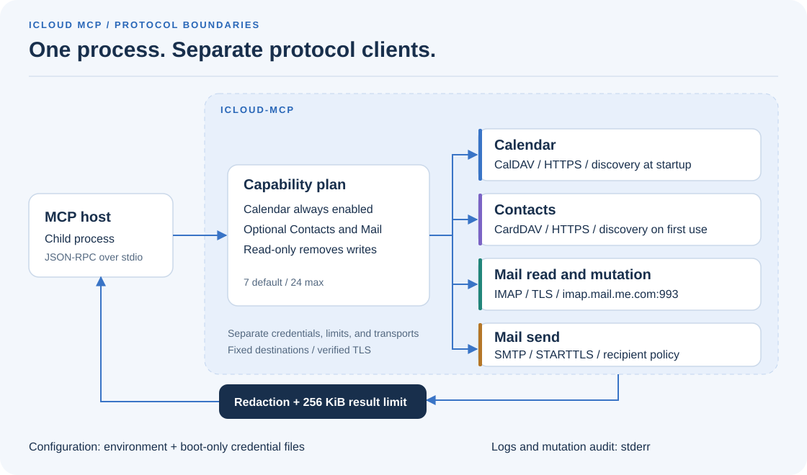

<!-- README standard: filmcraft-inspired/v4; profile: backend -->

<h1 align="center">icloud-mcp</h1>

<p align="center"><b>iCloud Calendar, Contacts, and Mail through one stdio MCP server.</b></p>

<p align="center">
  <a href="#get-started">Get started</a> |
  <a href="#mcp-tools">MCP tools</a> |
  <a href="#configuration">Configuration</a> |
  <a href="#documentation">Documentation</a>
</p>

Connect an MCP host to iCloud with one Go binary. Calendar uses CalDAV; optional
Contacts and Mail use CardDAV, IMAP, and SMTP. The host starts the process and
exchanges JSON-RPC through stdin and stdout.

<a id="how-this-differs"></a>
<!-- readme:section positioning -->
## Why icloud-mcp?

Use this server when an MCP host needs to search calendars, find free time, or
work with iCloud contacts and messages on a headless machine. It uses
app-specific passwords and remote protocols, without macOS frameworks, browser
automation, or private Apple APIs.

Capability gates let you start with Calendar reads and enable other operations
as needed. Each domain has its own protocol clients and network policy. All
enabled domains share one process: a process compromise can expose all loaded
credentials. Use separate processes and account configurations for stronger
isolation.

<a id="security-summary"></a>
<!-- readme:section privacy -->
## Privacy and security

**Accounts:** An Apple Account with iCloud Calendar and an app-specific password is required. Contacts uses the same identity. Optional Mail needs a full iCloud Mail address and can use a separate app-specific password. The server has no separate product account; the MCP host has its own account requirements.

**Telemetry:** The server has no telemetry or crash-reporting service. It writes operational logs and mutation audit records to stderr. The host controls log retention and has its own telemetry policy.

**Data:** Credentials are loaded at startup. Discovery state and keyed update results stay in process memory; the server writes no local data files. It sends authenticated requests to iCloud and returns account content to the MCP host. That host controls any further storage or transmission to a model provider.

- **Fixed destinations.** Calendar and Contacts use their iCloud hosts and
  validated shards on port 443. Mail uses `imap.mail.me.com:993` and
  `smtp.mail.me.com:587`, with mandatory STARTTLS for SMTP. TLS 1.2 or later is
  required. DAV ignores proxy environment variables.
- **Redaction and audit.** The server redacts configured identities, passwords,
  and Basic/SASL forms from errors, results, and logs. Mutation audits contain
  `domain`, `resourceType`, and a process-local HMAC `resourceToken`, without raw
  resource paths, UIDs, mailboxes, or recipients.
- **Host permissions.** Remote text can contain prompt injection. A compromised
  host model can invoke every registered tool. Start with global read-only mode
  and enable only the capabilities you need.

See the [threat model and reporting policy](SECURITY.md) and
[security implementation](docs/security.md).

<!-- readme:section capabilities -->
## Capability gates

| Capability | Operations | Enablement |
|---|---|---|
| Calendar | List calendars; search, get, and validate events; find free slots; create, update, and delete events | Reads always on; `calendar.write` and `calendar.delete` in `ICLOUD_MCP_PERMISSIONS` are required for effects; group-scheduled mutations also need `calendar.schedule` and `acknowledge_scheduling` |
| Contacts | List books; search and get contacts; create, update, and delete vCard 3.0 contacts | Reads require `ICLOUD_MCP_ENABLE_CONTACTS=true`; writes require `contacts.write` or `contacts.delete` |
| Mail read | List mailboxes; search messages; get plain text and attachment metadata | `ICLOUD_MCP_ENABLE_MAIL=true` |
| Mail mutation | Change flags; move or trash a message | Mail plus `mail.mutate` or `mail.trash` |
| Mail send | Submit a plain-text message, or reply to one with preserved conversation headers, through SMTP | Mail plus `mail.send` and a recipient policy |

`ICLOUD_MCP_READ_ONLY=true` removes every mutation and send tool from
`tools/list`. It does not enable a disabled read domain. Contacts has no separate
write flag. Mail mutation and send have independent gates. A send policy is
required whenever the send flag is set, including under global read-only.

`ICLOUD_MCP_RESOURCE_SCOPES` optionally limits which calendars, address books,
and mailboxes an agent may use. It is a semicolon-separated list of
`action=value[,value]` entries. Actions are `calendar.read`, `calendar.write`,
`calendar.delete`, `contacts.read`, `contacts.write`, `contacts.delete`,
`mail.read`, `mail.mutate`, and `mail.archive`. A literal `*` keeps an action
unrestricted.

Calendar values are paths. Contacts values are opaque identifiers or exact
display names. Mail values are exact mailbox names. Omitted action scopes fall
back to the read or write scope for that domain. Direct identifier injection is
checked before the domain operation. Ambiguous or stale Contacts names fail
closed. The variable is invalid if an action is unknown, duplicated, empty, or a
Calendar path is malformed.

`ICLOUD_MCP_PERMISSIONS` names every capability. It takes a comma-separated
list: `calendar.read`, `calendar.write`, `calendar.delete`, `calendar.schedule`,
`contacts.read`, `contacts.write`, `contacts.delete`, `mail.read`, `mail.mutate`,
`mail.trash`, `mail.send`, and `mail.archive`. `calendar.schedule` is a separate
operator grant for group-scheduled Calendar mutations and requires
`calendar.write` or `calendar.delete`. Domain switches still enable a domain. Global
read-only still removes every mutation and send. With no value, enabled
domains are read-only. No switch, flag, or omission implies an effect. For
example, `calendar.read,mail.read,mail.send` gives Calendar reads and Mail send
without Calendar, Contacts, or Mail mutation tools.

<!-- readme:section interface -->
## MCP tools

The server registers **7 tools with the default read-only profile**, including
the global capability tool, and **24 when explicit permissions and domain gates enable every capability**.
Disabled tools are absent from discovery. The MCP interface provides tools over
**stdio**.

| Tool | Input | Result | Account changes |
|---|---|---|---|
| `icloud_capabilities` | No arguments | Enabled domains, effective capabilities, version, tool names and count | None; the call uses local state |
| `list_calendars` | No arguments | Calendar names and paths for subsequent calls | None |
| `search_events` | `start`, `end`; optional calendar, filters, and cursor | Sorted event page with `calendar`, recurrence occurrences, truncation or failure warnings, and optional `nextCursor` | None |
| `update_event` | `calendar`, `uid`, changed fields; optional `etag`, `idempotency_key`, occurrence scope | Updated event or a structured error | Conditional Calendar write |
| `get_message` | `mailbox`, `uid_validity`, `uid`; optional body limit and HTML fallback | Message metadata and bounded plain text | None; EXAMINE and PEEK preserve read state |
| `send_message` | `body`, optional `subject`, `idempotency_key`, and at least one recipient across `to`, `cc`, `bcc` | Submission status or a structured error | Sends mail to allowed recipients; identical keyed calls reuse one submission |
| `reply_message` | source `mailbox`, `uid_validity`, `uid`; `body`; optional `mode` and `idempotency_key` | Submission status or a structured error | Replies to the resolved sender or reply-all recipients; never marks Answered or appends Sent |

The [complete inventory](docs/architecture.md#tool-inventory) lists all tools.
Run `icloud-mcp -doctor` for authenticated read-only network checks. Add
`-doctor-format=json` for machine-readable output. The command validates local
configuration, then probes enabled domains with a 10-second timeout each. It
never creates, updates, moves, trashes, or sends. Exit status is 0 when every
enabled domain is ready and 1 when a probe fails. Disabled domains stay
`disabled`; enabled domains are never reported ready before a successful probe.

`-doctor` is not an offline profile check. It discovers collections and mailboxes
outside MCP resource filtering, and it does not probe SMTP. See the
[diagnostic authorization limits](docs/agent-hosts.md#authenticated-diagnostics).
It is not available in v0.4.3. For credential-free TLS checks and hosted-network limitations,
see [Mail network troubleshooting](docs/mail-network-troubleshooting.md).

Representative read tools also publish output schemas and `structuredContent`.
Their text content remains for older hosts. Both forms come from the same
redacted values.
Discover their argument schemas with the host's tool list. Domain failures set
the MCP error flag and include a JSON `code` in text content. Follow the
[error and recovery reference](docs/error-codes.md).

<a id="quick-start"></a>
<!-- readme:section get-started -->
## Get started

This first run gives an MCP host read-only Calendar access. You need an MCP
host, network access to iCloud, and an Apple Account with two-factor
authentication to
[create an app-specific password](https://support.apple.com/en-us/102654).
Never use the main Apple Account password.

**Read-only by default.** With no `ICLOUD_MCP_PERMISSIONS`, the server exposes
reads only. Keep `ICLOUD_MCP_READ_ONLY=true` for the first run. No switch or
omission grants an effect.

### Choose an install path

| Path | Use when | Installation evidence |
|---|---|---|
| **MCPB bundle** (recommended) | Your host installs MCPB files and you do not want Go | Bundle build, manifest validation, native startup, and signatures are verified. **Real host installation is UNVERIFIED** ([#126](https://github.com/ThomasCrouzet/icloud-mcp/issues/126)). |
| **Release archive** | Linux amd64/arm64 or macOS arm64, with a manual host command | Native archive smoke is verified on the matching platform. Host configuration is manual. |
| **`go install`** | You develop with Go 1.26.0 or newer | Build, tests, and protocol checks are verified locally and in CI. |

The MCPB path is first because it needs no compiler. The missing evidence is a
recorded install in a named host version, not a bundle defect. Until that record
exists, this page does not claim that an MCPB host install was performed.

### Path A: MCPB bundle (host installation unverified)

1. Download the bundle for your platform from the
   [`v1.1.0` release](https://github.com/ThomasCrouzet/icloud-mcp/releases/tag/v1.1.0):
   [`linux-amd64`](https://github.com/ThomasCrouzet/icloud-mcp/releases/download/v1.1.0/icloud-mcp-v1.1.0-linux-amd64.mcpb),
   [`linux-arm64`](https://github.com/ThomasCrouzet/icloud-mcp/releases/download/v1.1.0/icloud-mcp-v1.1.0-linux-arm64.mcpb),
   or
   [`darwin-arm64`](https://github.com/ThomasCrouzet/icloud-mcp/releases/download/v1.1.0/icloud-mcp-v1.1.0-darwin-arm64.mcpb).
2. Download
   [`icloud-mcp-v1.1.0-checksums.txt`](https://github.com/ThomasCrouzet/icloud-mcp/releases/download/v1.1.0/icloud-mcp-v1.1.0-checksums.txt)
   and the matching `.sig` and `.pem` files. Verify the bytes:

   ```sh
   shasum -a 256 -c icloud-mcp-v1.1.0-checksums.txt
   cosign verify-blob \
     --certificate icloud-mcp-v1.1.0-linux-amd64.mcpb.pem \
     --signature icloud-mcp-v1.1.0-linux-amd64.mcpb.sig \
     --certificate-identity "https://github.com/ThomasCrouzet/icloud-mcp/.github/workflows/ci.yml@refs/tags/v1.1.0" \
     --certificate-oidc-issuer "https://token.actions.githubusercontent.com" \
     icloud-mcp-v1.1.0-linux-amd64.mcpb
   ```

3. Open the `.mcpb` file in your MCPB-capable host, or use that host's install
   command. The host reads `manifest.json`, asks for the declared user settings,
   and starts `${__dirname}/server/icloud-mcp`.
4. Set `email` and the app-specific password. Keep `read_only=true`,
   `permissions=calendar.read`, `enable_contacts=false`, and `enable_mail=false`.
   Set your IANA `default_timezone`.
5. Start the connector and confirm exactly seven tools. Call
   `icloud_capabilities` and confirm `readOnly` is true.
6. Restart the host and confirm the settings survive. Uninstall by removing the
   bundle from the host, then revoke the app-specific password at Apple.

**Unverified host part.** The host name, host version, OS/arch, settings
persistence, secret storage, upgrade behavior, and disable/uninstall behavior
are not recorded yet. If the host rejects manifest version `0.4`, the command,
or the bundle platform, use Path B and report the exact host name and version in
[#126](https://github.com/ThomasCrouzet/icloud-mcp/issues/126). Do not send
credentials or account data in that report.

The [MCPB guide](docs/distribution/mcpb.md) lists the manifest settings, entry
set, and trust chain. The [release verification procedure](docs/testing.md#release-metadata-and-registry)
covers checksums and signatures in more detail.

### Path B: release archive

Download the archive for Linux amd64/arm64 or macOS arm64 from the
[release page](https://github.com/ThomasCrouzet/icloud-mcp/releases), verify the
checksum and signature, then extract it:

```sh
tar -xzf icloud-mcp-v1.1.0-linux-amd64.tar.gz
./icloud-mcp -version
```

Use the extracted absolute path in the host configuration below. The archive
contains the same native binary as the bundle. It does not include a host
installer.

### Path C: go install

With **Go 1.26.0 or newer**:

```sh
go install github.com/ThomasCrouzet/icloud-mcp/cmd/icloud-mcp@latest
go env GOPATH GOBIN
```

The executable is installed in `GOBIN` when set, otherwise in `bin` under
`GOPATH` (normally `$HOME/go/bin`). Use its absolute path in the host config.

### Prepare credentials

Create one app-specific password for this server. Never use the main Apple
Account password. Store the Apple Account identity and the app-specific password
in separate files outside the repository. Each must be a regular file of at
most 4 KiB, with mode `0600` or stricter. The host user must be able to read
them. Use absolute `file://` paths; the server reads these files only at
startup.

For an MCPB host, prefer the masked password settings. If the host cannot store
secrets, enter the documented `file://` value in the string setting. See
[MCPB user settings](docs/distribution/mcpb.md#user-settings-and-credentials).

### Configure the host

This manual example uses **Claude Desktop on macOS**. Open **Settings >
Developer > Edit Config**. Its user configuration file is
`~/Library/Application Support/Claude/claude_desktop_config.json`; see the
[official local-server setup guide](https://modelcontextprotocol.io/docs/develop/connect-local-servers)
and [environment configuration](https://modelcontextprotocol.io/docs/tools/debugging#environment-variables).
Merge this entry into `mcpServers`, with your actual absolute paths:

```json
{
  "mcpServers": {
    "icloud": {
      "command": "/Users/you/go/bin/icloud-mcp",
      "env": {
        "ICLOUD_EMAIL": "file:///Users/you/.config/icloud-mcp/email",
        "ICLOUD_PASSWORD": "file:///Users/you/.config/icloud-mcp/password",
        "ICLOUD_MCP_READ_ONLY": "true",
        "ICLOUD_MCP_PERMISSIONS": "calendar.read",
        "ICLOUD_MCP_ENABLE_CONTACTS": "false",
        "ICLOUD_MCP_ENABLE_MAIL": "false",
        "ICLOUD_MCP_ENABLE_MAIL_WRITE": "false",
        "ICLOUD_MCP_ENABLE_MAIL_SEND": "false",
        "ICLOUD_MCP_DEFAULT_TZ": "Europe/Paris"
      }
    }
  }
}
```

Keep optional domains off for this run. Fully quit and reopen the host. The host
launches the binary. Calendar discovery starts on the first Calendar call, so a
remote Calendar outage does not block an optional domain. Open the host's
connector tool list and confirm the `icloud` tools appear.

For an MCPB host, use the host's settings form instead of this JSON. The
manifest maps the same values to the same environment variables. Do not paste a
password into a public configuration file.

This entry is also available as
[calendar-read-only.json](examples/profiles/calendar-read-only.json).
Choose one of the [five tested profiles](docs/agent-hosts.md#supported-profiles)
for Calendar, Contacts, Mail, scoped Calendar writes, or exact-recipient send.
Only the three read-only profiles are recommended for first use.

The local binary can return account data to the configured MCP host and model.
Their policies govern onward transmission. Local stdio does not keep that data
outside the host or model. Review those policies before the first account read.
For synthetic-only startup checks, use the
[offline validation commands](docs/agent-hosts.md#offline-profile-validation)
or the [synthetic first-run transcript](docs/demo/read-only-transcript.md).

### Run your first operation

Ask the host:

```text
Call icloud_capabilities and confirm readOnly is true.
Compare its tools with the host's tools/list. No write, delete, mutate, or send tool may appear.
For this Calendar profile, the current toolCount is 7.
Then call list_calendars with no arguments and show the calendar names.
```

The first call confirms capability discovery. The second reads iCloud. It
returns `count` and a `calendars` array with `name` and `path` fields. An account
with no calendars returns an empty array. A synthetic protocol fixture returns:

```json
{
  "count": 1,
  "calendars": [
    {"path": "/fixture/calendars/home/", "name": "Fixture Calendar"}
  ]
}
```

This output comes from the repository fixture, not a live account. Your names,
paths, and count depend on your account. Next, ask the host to use
`search_events` for the next seven days.

For another host, configure a custom stdio process with the same command and
environment; its configuration format can differ. See
[host integration](docs/agent-hosts.md).

### If the first start fails

| Symptom | Check |
|---|---|
| The host rejects the bundle | Host name and version are not yet verified. Use Path B. Report the host version in #126. |
| `configuration error` | The identity, password, gate, or timezone value is invalid. Fix it before retrying. |
| `authentication` | Use a new app-specific password. Never use the main password. |
| Calendar tools are absent | The host did not start the process or the tool list is stale. Restart the host. |
| Write or send tools appear | Set `ICLOUD_MCP_READ_ONLY=true` and use only `calendar.read`. Report the host configuration. |

<!-- readme:section configuration -->
## Configuration

The binary reads exactly **15 product environment variables** from its process
environment. It does not load `.env` files or host configuration files.
[`.env.example`](.env.example) lists the supported keys. The host or launching
shell must supply them; restart the process after a change.

| Variable | Required | Default | Purpose |
|---|---|---|---|
| `ICLOUD_EMAIL` | Calendar or Contacts requested | None | Calendar and Contacts identity; supports `file://` |
| `ICLOUD_PASSWORD` | Calendar/Contacts, or Mail password fallback | None | App-specific password; supports `file://` |
| `ICLOUD_MCP_READ_ONLY` | No | `false` | Remove every mutation and send tool |
| `ICLOUD_MCP_PERMISSIONS` | No | Reads only | Explicit comma-separated capability list |
| `ICLOUD_MCP_RESOURCE_SCOPES` | No | All resources | Per-action Calendar, Contacts, and Mail resource allowlists |
| `ICLOUD_MCP_LOG_LEVEL` | No | `info` | Operational stderr log level |
| `ICLOUD_MCP_DEFAULT_TZ` | No | `UTC` | IANA zone for Calendar times without an offset and recurring-write fallback |
| `ICLOUD_MCP_ENABLE_CONTACTS` | No | `false` | Enable Contacts reads; writes require `contacts.write` or `contacts.delete` |
| `ICLOUD_MCP_ENABLE_MAIL` | No | `false` | Enable Mail reads |
| `ICLOUD_MAIL_ADDRESS` | When Mail is on | None | Full iCloud Mail address; supports `file://` |
| `ICLOUD_MAIL_FROM` | No | `ICLOUD_MAIL_ADDRESS` | Sender address for From and `MAIL FROM`, for example an iCloud+ custom-domain address; login stays on `ICLOUD_MAIL_ADDRESS`; supports `file://` |
| `ICLOUD_MAIL_PASSWORD` | No | `ICLOUD_PASSWORD` | Separate Mail app-specific password; supports `file://` |
| `ICLOUD_MCP_ENABLE_MAIL_WRITE` | No | `false` | Compatibility gate only; Mail mutation requires `mail.mutate` or `mail.trash` |
| `ICLOUD_MCP_ENABLE_MAIL_SEND` | No | `false` | Compatibility gate only; send requires `mail.send` and a recipient policy |
| `ICLOUD_MCP_SMTP_ALLOWED_RECIPIENTS` | When send is requested | None | Comma-separated exact addresses, or literal `*` |

Boolean values accept unset, `0`, `false`, `1`, and `true`; the parser trims
whitespace and ignores case. Invalid values fail before network access. Pass
environment values as strings, including quoted booleans in YAML. Mail write
or send without Mail is a boot error. Prefer exact recipient addresses: literal
`*` permits any syntactically valid recipient and causes a boot warning.

For Calendar times, use an explicit RFC3339 offset or a local time without an
offset in `ICLOUD_MCP_DEFAULT_TZ`. Do not label a local hour with `Z`. Timed
results include an explicit numeric offset; all-day dates use `YYYY-MM-DD`. A
floating source value stays offset-free and sets `isFloating`. A recurrence
occurrence resolved from a spring gap sets `dstAdjusted`.
See the [full configuration and date rules](docs/agent-hosts.md#configuration-reference)
for log-level forms and optional-domain examples.

Version **1.0.0** makes read-only the default. An unset
`ICLOUD_MCP_PERMISSIONS` grants reads only; a domain switch or
`ICLOUD_MCP_READ_ONLY=false` does not grant an effect. Existing v0.x
configurations that relied on implicit Calendar or Contacts writes must add the
exact tokens before upgrading. See the
[v1.0.0 migration](docs/agent-hosts.md#v100-default-migration) for the token
list and examples.

<!-- readme:section operations -->
## Operations

| Area | Behavior |
|---|---|
| Lifecycle | Configuration validates before network access. Calendar, Contacts, and Mail initialize independently. Calendar and Contacts discovery is lazy; Mail uses fresh sessions. A failing domain does not remove another domain. EOF and SIGTERM stop the stdio process. Use a separate process for each account. |
| Logs | stdout is reserved for JSON-RPC. Operational logs and mutation audits go to stderr. `-audit-format=json` is the default; `text` is also supported. |
| Health | Disabled by default. `-health 127.0.0.1:8797` enables loopback-only `/healthz` and `/status` with domain status and rate limits. Enabled domains start as `not_checked`. Use `-doctor` for bounded read-only probes. These are monitoring endpoints; MCP remains stdio. |
| Read retries | Calendar and Contacts retry bounded HTTP status failures. A transient IMAP read can use one replacement session. |
| Mutations | Calendar/Contacts writes, IMAP mutations, and SMTP never replay automatically. An `outcome_unknown` result requires reconciliation before another mutation. An event with organizer or attendee metadata stays denied until an explicit operator permission grant, `acknowledge_scheduling=true`, and the current strong ETag are present. |
| Update keys | `update_event` and `update_contact` retain keyed results in memory. Known results last 15 minutes; uncertain results remain until process exit. Restart removes the cache without resolving outcomes. |

Use strong ETags for Calendar and Contacts updates and deletes. Creates use
`If-None-Match: *`; updates and deletes use a strong `If-Match`. For creates,
`client_uid` or its `idempotency_key` alias identifies the resource. For keyed
updates, follow the [cache contract](docs/architecture.md#update-idempotency)
and [recovery procedure](docs/error-codes.md#update-idempotency-and-recovery).

### Limits

Tools have a 25 s deadline and DAV a 30 s HTTP timeout. Stdio frames are limited
to 1 MiB and MCP results to 256 KiB. Calendar and Contacts each allow 60 reads
and 20 writes per minute. Mail has separate limits of 60 reads, 20 mutations,
and 20 sends per minute. See the [public limits](docs/architecture.md#public-limits)
for search, parser, recurrence, and concurrency bounds.

<!-- readme:section documentation -->
## Documentation

| Guide | Contents |
|---|---|
| [Host integration](docs/agent-hosts.md) | Secrets, all configuration keys, dates, health, multiple accounts, caller behavior |
| [Architecture](docs/architecture.md) | Startup, boundaries, full tool inventory, limits, update idempotency |
| [Error codes](docs/error-codes.md) | Structured errors, retry rules, mutation reconciliation |
| [CalDAV compatibility](docs/caldav-compatibility.md) | Calendar discovery, conditional writes, recurrence |
| [CardDAV compatibility](docs/carddav-compatibility.md) | Contacts discovery, search, vCard formats and writes |
| [Mail compatibility](docs/mail-compatibility.md) | IMAP identities, sessions, MIME bounds, mutations, SMTP |
| [Mail network troubleshooting](docs/mail-network-troubleshooting.md) | Version-specific diagnostics, credential-free TLS checks, approved deployment networks |
| [Security policy](SECURITY.md) and [implementation](docs/security.md) | Threat model, private reporting, technical controls |
| [MCPB bundles](docs/distribution/mcpb.md) | Bundle contents, user settings, verification, unverified host path |
| [Case study](docs/case-study.md) | Architecture, mutation boundaries, evidence, limitations |
| [Synthetic first run](docs/demo/read-only-transcript.md) | Reproducible read-only transcript with no account |
| [Testing](docs/testing.md) | Local checks, protocol evidence, CI, live integration, release verification |
| [Releases](https://github.com/ThomasCrouzet/icloud-mcp/releases) and [Changelog](CHANGELOG.md) | Published archives and version history |

### Build and test

From the repository root, use Go 1.26.0 or newer and Make. Build and test need
no iCloud account or running service. CI and release builds pin Go 1.26.10.

```sh
make build        # bin/icloud-mcp, host Go; version defaults to dev
make test         # go test ./... -race -cover
make lint         # go vet and pinned golangci-lint v2.15.0
```

`make release-all VERSION=vX.Y.Z` packages Linux amd64/arm64 and macOS arm64
with the host toolchain. `make release VERSION=vX.Y.Z` uses a pinned Docker
image for Linux arm64. Replace `vX.Y.Z` with a release version. Both require a
clean worktree, including untracked files, and refuse to overwrite output.
Tag releases build after CI and gitleaks pass. Live integration tests require
credentials and explicit gates; see [Testing](docs/testing.md).

### Contributing

Follow [CONTRIBUTING.md](CONTRIBUTING.md). Run `gofmt`, `make test`, and
`make lint` before opening a pull request. Report bugs through
[GitHub Issues](https://github.com/ThomasCrouzet/icloud-mcp/issues), with the
version, enabled domains, reproduction steps, and redacted errors. Report
vulnerabilities privately through [SECURITY.md](SECURITY.md).

<!-- readme:section status -->
## Status

The implemented scope is iCloud Calendar with optional Contacts and Mail.

| Target | Published archive | Native release smoke | Status |
|--------|-------------------|----------------------|--------|
| Linux amd64 | Yes | Ubuntu GitHub-hosted runner | Supported |
| Linux arm64 | Yes | Ubuntu arm64 GitHub-hosted runner | Supported |
| macOS arm64 | Yes | macOS GitHub-hosted arm64 runner | Supported |
| Windows amd64 | No | None | Compile-only, explicit scope decision |

Windows has no signed archive and no runtime support claim. Compilation is not
evidence of file-credential handling, service startup, or installation. See the
[platform support and evidence matrix](docs/platform-support.md) for the
compiled, published, archive-verified, and native-executed distinction.

Install without Go by downloading `icloud-mcp-vX.Y.Z-<os>-<arch>.tar.gz` and
`icloud-mcp-vX.Y.Z-checksums.txt` from the release. Verify the checksum and
cosign signature, extract `icloud-mcp`, and use its absolute path in the host
configuration. See the [release verification procedure](docs/testing.md#release-metadata-and-registry).

Current limits to account for:

- **Calendar.** Recurring operations support a full series or one occurrence.
  `this-and-future` and RDATE are unsupported. A search range is at most 366 days.
- **Contacts.** Reads accept vCard 3.0 and 4.0. Writes support 3.0 only; vCard
  4.0 and groups are read-only. Full-object updates preserve PHOTO and unknown
  fields.
- **Mail.** Message identity is `(mailbox, UIDVALIDITY, UID)`. Reads return
  plain text and attachment metadata, without HTML or attachment bodies.
  `move_message` rejects SPECIAL-USE Trash and Junk destinations; use
  `trash_message` for intentional deletion. When CONDSTORE is advertised,
  `set_message_flags` requires `expected_modseq`. The adapter validates one UID
  STORE from the returned FETCH metadata, reports `concurrent_modification` for
  a stale MODSEQ, and never retries the write.
- **Scope.** Reminders, Notes, Photos, Drive, Find My, Keychain, Messages, and
  Home are outside the supported scope. Modern Reminders are not exposed by
  this CalDAV connector.

<!-- readme:section architecture -->
## Architecture



Each domain keeps separate credentials, transports or dialers, rate limiters,
and semaphores. Shared code handles redaction, audit, result bounds, and the
process lifecycle. See the [package map](docs/architecture.md#packages).

### Direct dependencies

The single Go module has **12 direct requirements**: **11 runtime dependencies**
and **one explicit test dependency**. Exact versions
are in [go.mod](go.mod); required notices are in
[THIRD_PARTY_NOTICES.md](THIRD_PARTY_NOTICES.md).

| Dependency | Purpose |
|---|---|
| `github.com/emersion/go-webdav` | CalDAV primitives; custom discovery and conditional requests preserve iCloud behavior |
| `github.com/emersion/go-ical` | iCalendar parsing and encoding |
| `github.com/mark3labs/mcp-go` | MCP stdio transport, schemas, and JSON-RPC |
| `github.com/teambition/rrule-go` | Bounded recurrence expansion with timezone preservation |
| `golang.org/x/time` | Independent domain rate limiters |
| `golang.org/x/text` | RFC 5051-compatible Unicode collation for local Contacts matching; already present transitively |
| `github.com/emersion/go-vcard` | vCard 3.0/4.0 reads and 3.0 writes |
| `github.com/emersion/go-imap/v2` | IMAP through the narrow `internal/mail/imapadapter` boundary |
| `github.com/emersion/go-message` | MIME parsing and bounded plain-text handling |
| `github.com/emersion/go-smtp` | SMTP submission with STARTTLS |
| `github.com/emersion/go-sasl` | SASL PLAIN authentication after STARTTLS |
| `github.com/santhosh-tekuri/jsonschema/v6` | Test-only explicit import for conformance checks of published schemas and actual outputs; the validator already exists transitively through the MCP SDK |

<a id="license"></a>
<!-- readme:section license -->
## License and credits

MIT. Copyright (c) 2026 Thomas Crouzet. See [LICENSE](LICENSE) and
[third-party notices](THIRD_PARTY_NOTICES.md).

### Attribution

Calendar tool shape and several patterns were inspired by
[`github.com/roygabriel/mcp-icloud-calendar`](https://github.com/roygabriel/mcp-icloud-calendar)
(MIT, copyright 2026 Gabe). Code was rewritten, not copied.
