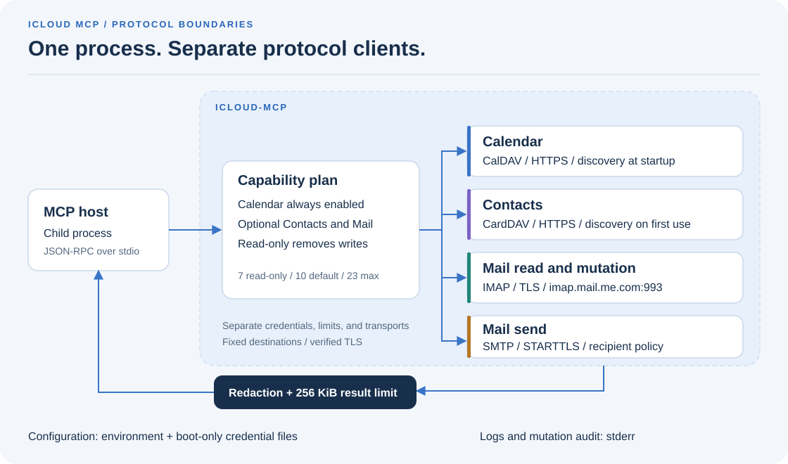

# icloud-mcp

[](https://github.com/ThomasCrouzet/icloud-mcp/actions/workflows/ci.yml)
[](https://github.com/ThomasCrouzet/icloud-mcp/releases)
[](LICENSE)

Access **iCloud Calendar, Contacts, and Mail** through
[Model Context Protocol](https://modelcontextprotocol.io). One Go binary serves
JSON-RPC over **stdio** and connects through CalDAV, CardDAV, IMAP, and SMTP.



The server runs headless with app-specific passwords. It uses remote protocols,
without macOS frameworks, browser automation, or private Apple APIs.
Release archives support Linux amd64/arm64 and macOS arm64. CI also builds Windows amd64.

Any stdio MCP host can start the binary with its process environment.
The binary does not load `.env` or host-specific configuration files.

| Domain | Protocol | Default |
|--------|----------|---------|
| Calendar | CalDAV HTTPS | Always on (read + write unless global read-only) |
| Contacts | CardDAV HTTPS | Off until `ICLOUD_MCP_ENABLE_CONTACTS` |
| Mail read | IMAP TLS | Off until `ICLOUD_MCP_ENABLE_MAIL` |
| Mail mutation | IMAP | Off until Mail + `ICLOUD_MCP_ENABLE_MAIL_WRITE` |
| Mail send | SMTP STARTTLS | Off until Mail + `ICLOUD_MCP_ENABLE_MAIL_SEND` + recipient policy |

Reminders, Notes, Photos, Drive, Find My, Keychain, Messages, and Home are outside
the supported scope. Modern Reminders do not use this server's CalDAV connector.

## Quick start

Use Go 1.26.0 or later:

```bash
go install github.com/ThomasCrouzet/icloud-mcp/cmd/icloud-mcp@latest
```

1. Create an [app-specific password](https://appleid.apple.com). Never use the
   main Apple Account password.
2. Store the identity and password in separate regular files outside the repository.
3. Give each file mode `0600` or stricter and a maximum size of 4 KiB.
4. Set the environment for Calendar **read-only** access:

```bash
export ICLOUD_EMAIL='file:///private/path/icloud-email'
export ICLOUD_PASSWORD='file:///private/path/icloud-password'
export ICLOUD_MCP_READ_ONLY=true
export ICLOUD_MCP_DEFAULT_TZ=Europe/Paris   # owner IANA zone; default UTC
```

5. Register the absolute binary path and environment in your MCP host.
6. Restart the MCP process after configuration changes.

Stdio carries JSON-RPC. Stderr carries logs and mutation audit events.
The server reads credential files only at startup. Calendar discovery requires
network access before stdio starts.

This configuration exposes **7 tools**: Calendar reads, local helpers, and
`icloud_capabilities`. The process does not construct a Contacts or Mail client.

Optional domains (still host-agnostic `export` form):

```bash
# Contacts reads (writes also need ICLOUD_MCP_READ_ONLY=false)
export ICLOUD_MCP_ENABLE_CONTACTS=true

# Mail reads: IMAP identity may differ from ICLOUD_EMAIL (e.g. name@icloud.com)
export ICLOUD_MCP_ENABLE_MAIL=true
export ICLOUD_MAIL_ADDRESS='file:///private/path/icloud-mail-address'
# Optional separate password; otherwise Mail uses ICLOUD_PASSWORD.
# export ICLOUD_MAIL_PASSWORD='file:///private/path/icloud-mail-password'

# Mail mutation (flags / move / trash); independent of send
export ICLOUD_MCP_ENABLE_MAIL_WRITE=true
export ICLOUD_MCP_READ_ONLY=false

# Mail send: requires exact recipient allowlist even under global read-only
export ICLOUD_MCP_ENABLE_MAIL_SEND=true
export ICLOUD_MCP_SMTP_ALLOWED_RECIPIENTS='alice@example.com,bob@example.net'
```

See [.env.example](.env.example) for the full 12-variable contract.

## MCP tools

The server exposes a maximum of **23** tools. Disabled tools are absent from
`tools/list`. The process does not construct clients for disabled domains.

| Count | When |
|------:|------|
| **10** | Default: Calendar read+write + `icloud_capabilities` |
| **7** | Global read-only, optional domains off (recommended first run) |
| **23** | Contacts + Mail read + mutation + send, read-only off |

`ICLOUD_MCP_READ_ONLY=true` removes every Calendar/Contacts write, every Mail
mutation, and Mail send. It does not enable a disabled read domain.

| Group | Tools |
|-------|--------|
| Global | `icloud_capabilities` |
| Calendar read | `list_calendars`, `search_events`, `get_event`, `find_free_slots`, `validate_event`, `calendar_capabilities` |
| Calendar write | `create_event`, `update_event`, `delete_event` |
| Contacts read | `list_address_books`, `search_contacts`, `get_contact` |
| Contacts write | `create_contact`, `update_contact`, `delete_contact` |
| Mail read | `list_mailboxes`, `search_messages`, `get_message` |
| Mail mutation | `set_message_flags`, `move_message`, `trash_message` |
| Mail send | `send_message` |

Calendar update and delete operations support occurrences and use strong
`If-Match`. Contacts uses opaque book IDs and writes vCard 3.0.
Mail uses `(mailbox, UIDVALIDITY, UID)` identities, PEEK reads, and an exact
recipient policy for SMTP. `set_message_flags` fails closed with
`protocol_error` when CONDSTORE is advertised. This occurs because go-imap
beta.8 cannot observe tagged MODIFIED. See the full behavior notes:
[docs/caldav-compatibility.md](docs/caldav-compatibility.md),
[docs/carddav-compatibility.md](docs/carddav-compatibility.md),
[docs/mail-compatibility.md](docs/mail-compatibility.md).

### Create UIDs and update idempotency

`create_event` and `create_contact` use `client_uid` or its `idempotency_key`
alias as the resource UID. A create returns `conflict` if that UID exists.
It never silently overwrites the object.

Only `update_event` and `update_contact` cache results through `idempotency_key`.
The process-local cache holds 1,024 entries, with a 256 KiB maximum per payload.
The same key and parameters return the saved result. Different parameters return
`conflict`. Success and definitive errors remain for 15 minutes. Unknown outcomes
remain until process exit. Pending claims do not expire.

A full cache rejects new claims before a write. Keep the key and wait for capacity.
After an ambiguous response, use `get_event` or `get_contact` before a new update.
A new key or process restart does not prove that the previous write failed.
Use a fresh strong `etag` for a necessary new update.

See the [cache contract](docs/architecture.md#update-idempotency) and
[recovery procedure](docs/error-codes.md#update-idempotency-and-recovery).

## Configuration

Exactly **12** product environment variables:

| Variable | Default | Contract |
|----------|---------|----------|
| `ICLOUD_EMAIL` | none | Required Calendar/Contacts identity. `file://` supported (regular file, <=4 KiB, mode 0600+). |
| `ICLOUD_PASSWORD` | none | Required app-specific password. Mail uses it as a fallback. `file://` as above. |
| `ICLOUD_MCP_READ_ONLY` | `false` | Global mutation kill switch. |
| `ICLOUD_MCP_LOG_LEVEL` | `info` | Stderr level. See the accepted forms below. |
| `ICLOUD_MCP_DEFAULT_TZ` | `UTC` | IANA zone for offset-less Calendar inputs and recurring-write fallback. |
| `ICLOUD_MCP_ENABLE_CONTACTS` | `false` | Contacts tools. Writes require read-only mode to be off. |
| `ICLOUD_MCP_ENABLE_MAIL` | `false` | Mail reads. Requires a Mail address and password. |
| `ICLOUD_MAIL_ADDRESS` | none | Full IMAP/SMTP address when Mail is on. `file://` as above. |
| `ICLOUD_MAIL_PASSWORD` | `ICLOUD_PASSWORD` | Optional dedicated Mail app password. `file://` as above. |
| `ICLOUD_MCP_ENABLE_MAIL_WRITE` | `false` | Three IMAP mutation tools. |
| `ICLOUD_MCP_ENABLE_MAIL_SEND` | `false` | `send_message` (independent of Mail write). |
| `ICLOUD_MCP_SMTP_ALLOWED_RECIPIENTS` | none | Required if send is on. Use exact addresses or literal `*`. Literal `*` causes a boot warning. Use exact addresses when possible. |

Booleans accept only unset, `0`, `false`, `1`, or `true`. Invalid values cause a
boot failure. The server validates the configuration **before** network access.
Hosts must pass these values as strings. Quote a boolean in YAML, for example
`ICLOUD_MCP_READ_ONLY: "false"`. An unquoted YAML boolean fails host validation
before the server starts.
Mail write or send without Mail causes a boot error. Mail without an address or
password also causes a boot error. Send without a recipient policy causes a
boot error, including in read-only mode.

Global read-only can coexist with write and send flags, but it prevents their
registration.

The server trims log levels and ignores case. It accepts `debug` or `-4`,
`info`, `warn`, `warning`, or `2`, and `error` or `4`. Unset or unrecognized
values use `info`.

Use `-version` to print the version. The optional
`-health 127.0.0.1:port` flag serves `/healthz` and `/status` on loopback. Both
endpoints return JSON with domains and rate limits. The optional
`-audit-format=json|text` flag selects the mutation audit format on stderr.
The default format is `json`.

### Dates

- Calendar **input** `start` and `end` accept RFC3339 with an offset. They also
  accept wall-clock values without an offset in `ICLOUD_MCP_DEFAULT_TZ`. Use
  values without an offset for the user's local time. Recurring creates and
  creates with an explicit timezone write TZID and VTIMEZONE. Non-recurring
  timed creates default to UTC `Z` on the wire. All-day creates use
  `VALUE=DATE`.
- Calendar **output** uses RFC3339 for timed events. It always includes an
  explicit numeric offset in `ICLOUD_MCP_DEFAULT_TZ`, never bare `Z`. All-day
  dates use `YYYY-MM-DD`. See `calendar_capabilities.outputFormat`.
- Contacts birthdays: write `YYYY-MM-DD` only.
- Mail search: `since` inclusive, `before` exclusive (`YYYY-MM-DD`).

## Security (summary)

Untrusted remote text can influence an LLM on the host. Labels do not form a
security boundary. A compromised model can call every **registered** tool. This
risk applies to every host and vendor.

- **Egress fixed:** Calendar uses `caldav.icloud.com` and matching
  `p[0-9]{1,3}-caldav.icloud.com:443` hosts. Contacts uses matching Contacts
  hosts. IMAP uses `imap.mail.me.com:993`. SMTP uses
  `smtp.mail.me.com:587` with mandatory STARTTLS. Destinations are not
  configurable. The server ignores DAV proxy environment variables and verifies
  TLS 1.2 or later.
- **Isolation:** each domain has separate credentials, transports, dialers,
  limiters, semaphores, and protocol stacks. No authenticated HTTP client
  connects to multiple domains.
- **Secrets:** the server removes secrets, including Basic and SASL PLAIN forms.
  Boot-only `file://` reads require mode 0600 or stricter. The server does not
  use `os/exec` or telemetry. It does not write to disk after boot.
- **Audit:** mutation logs include `domain`, `resourceType`, and the process-local
  HMAC `resourceToken`. They never contain raw paths, UIDs, mailboxes, or
  recipients.
- **Residual risk:** one process holds credentials for all enabled domains.
  Feature flags do not remove compiled code. For stronger isolation, use
  read-only mode and enable fewer domains. You can also use a dedicated Mail
  password or separate processes.

Full policy: [SECURITY.md](SECURITY.md), [docs/security.md](docs/security.md).
Architecture: [docs/architecture.md](docs/architecture.md).

## Limits (summary)

| | |
|--|--|
| Tool deadline | 25s (DAV HTTP 30s) |
| Stdio / MCP result | 1 MiB frame. 256 KiB result. Reflected protocol errors have a limit. |
| Calendar | Search range: 366 days. Results: 400 total, 2,500 per calendar, and 10,000 materialized across calendars. Recurrence: 2,000 expansions, 100k steps per series, and 250k steps per search. Rate: 60 reads and 20 writes per minute. Concurrency: 4 reads and 2 writes. |
| Contacts | 100 books. 100 summaries. 2000 cards scanned. Rate: 60 reads and 20 writes per minute. Concurrency: 4. |
| Mail | Rate: 60 reads, 20 mutations, and 20 sends per minute. Semaphores: 2 reads, 1 mutation, and 1 send. No mutation or send retry. |
| Writes | No automatic replay of Calendar PUT/DELETE, Contacts writes, IMAP mutations, or SMTP. Ambiguous outcomes use `outcome_unknown`. |

The server discovers Calendar at boot and Contacts when first used. Each call
uses a fresh IMAP or SMTP session. See these documents for rates, parser
budgets, and retry rules:
[docs/testing.md](docs/testing.md), [docs/architecture.md](docs/architecture.md).

### Multiple accounts

One process holds one iCloud identity. Start a separate process for each identity.
Give each process a separate environment and optional health port.
See [host integration](docs/agent-hosts.md).

## Dependencies

Use Go 1.26.0 or newer. The project has one module and exactly **10** direct
dependencies. If you add a direct dependency, add its justification here.

| Dependency | Exact version | Justification |
|------------|---------------|---------------|
| `github.com/emersion/go-webdav` | `v0.7.0` | CalDAV primitives. Discovery and conditional operations remain hand-written. |
| `github.com/emersion/go-ical` | `v0.0.0-20250609112844-439c63cef608` | iCalendar parse/encode |
| `github.com/mark3labs/mcp-go` | `v1.2.0` | MCP stdio, schemas, JSON-RPC |
| `github.com/teambition/rrule-go` | `v1.8.2` | Bounded recurrence with timezone preservation |
| `golang.org/x/time` | `v0.16.0` | Per-domain rate limiters |
| `github.com/emersion/go-vcard` | `v0.1.0` | vCard 3.0/4.0 read, 3.0 write |
| `github.com/emersion/go-imap/v2` | `v2.0.0-beta.8` | IMAP behind `internal/mail/imapadapter` |
| `github.com/emersion/go-message` | `v0.18.2` | MIME / plain-text bounds |
| `github.com/emersion/go-smtp` | `v0.25.0` | SMTP + STARTTLS |
| `github.com/emersion/go-sasl` | `v0.0.0-20241020182733-b788ff22d5a6` | SASL PLAIN after STARTTLS |

## Build and test

```bash
make build        # local host binary, VERSION defaults to dev
make test         # go test ./... -race -cover
make lint         # go vet + pinned golangci-lint
make release VERSION=v0.4.0      # packaged linux/arm64, digest-pinned Go 1.26.9 image
make release-all VERSION=v0.4.0  # packaged linux/amd64, linux/arm64, darwin/arm64 (host Go)
make install      # host-compatible build to INSTALL_DIR (default ~/.local/bin)
```

Release targets require a clean worktree and a non-`dev` version. Archives contain
the binary, `LICENSE`, and `THIRD_PARTY_NOTICES.md`. The `dist/` directory also
contains a SHA-256 checksum file. GitHub tag releases run `make release-all`
only after CI and gitleaks succeed for that tag. They use Go 1.26.9 with
`check-latest` disabled.

Local `make release` uses the digest-pinned container path for linux/arm64.
Release blobs include cosign keyless signatures. `-version` first uses the
release ldflags value. If this value is absent, it uses Go module build
information. Thus, `go install ...@version` reports the module version.

CI checks formatting, race tests, fuzzing, vulnerabilities, secrets, public text,
and multi-architecture builds. It enforces coverage floors and a 20 MiB binary limit.
Live tests require the `integration` build tag and explicit domain/write gates.
CI never runs them. See [Testing](docs/testing.md).

For fixture-only protocol evidence, use an absolute output path outside the
repository:

```bash
make protocol-evidence EVIDENCE_DIR=/external/path
```

The runner builds an executable from `cmd/icloud-mcp` tests with shared MCP
registration and stdio startup code. It also runs in-process idempotency and
recurrence scenarios. It saves transcripts, run metadata, source revision,
working diff, fixture SHA-256 values, and results outside the repository.
CI keeps the `protocol-evidence` artifact for 14 days. These checks use synthetic
fixtures and do not establish live iCloud compatibility.

## Documentation

| Document | Purpose |
|----------|---------|
| [Host integration](docs/agent-hosts.md) | YAML and JSON setup, multi-account processes, caller behavior |
| [Error codes](docs/error-codes.md) | Retry rules and mutation recovery |
| [Architecture](docs/architecture.md) | Startup, domain boundaries, concurrency, update idempotency |
| [CalDAV compatibility](docs/caldav-compatibility.md) | Calendar discovery, conditional writes, recurrence, limits |
| [CardDAV compatibility](docs/carddav-compatibility.md) | Contacts discovery, vCard support, search, conditional writes |
| [Mail compatibility](docs/mail-compatibility.md) | IMAP sessions, message identity, mutation, SMTP submission |
| [Security policy](SECURITY.md) and [implementation](docs/security.md) | Threat model, reporting, and technical controls |
| [Testing](docs/testing.md) | Local checks, protocol evidence, CI, and live-integration gates |
| [Contributing](CONTRIBUTING.md) | Development, writing, testing policy, and support |
| [Changelog](CHANGELOG.md) | Release history |

## Attribution

Calendar tool shape and several patterns were inspired by
[`github.com/roygabriel/mcp-icloud-calendar`](https://github.com/roygabriel/mcp-icloud-calendar)
(MIT, copyright 2026 Gabe). Code was rewritten, not copied. This server adds
hard per-domain egress, redaction, bounded parsers, conditional mutation,
Contacts, Mail, and no telemetry.

## Contributing

See [CONTRIBUTING.md](CONTRIBUTING.md). Run `gofmt`, `make test`, and `make lint`
before opening a pull request.

## License

MIT. See [LICENSE](LICENSE) and [third-party notices](THIRD_PARTY_NOTICES.md).
